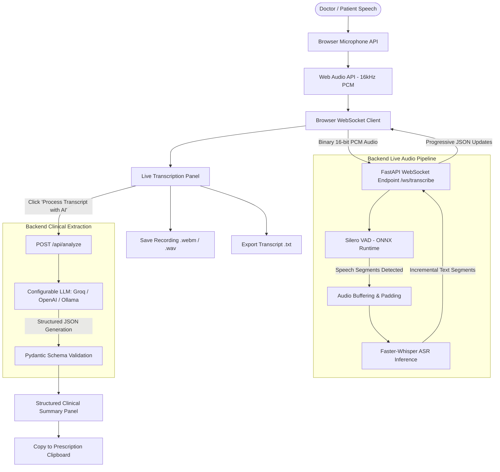

# AI-Powered Live Medical Transcription and Clinical Summary Application

A complete, production-grade web application for real-time medical consultation transcription and automated structured clinical summarization, strictly built to match the design and requirements in **AI Assignment.pdf**.

---

## 📸 Interface Design & Reference Alignment

The user interface follows the reference design on Page 1 of the assignment PDF:
- **Clean Two-Column Dashboard**: Responsive two-column layout on desktop, responsive single-column layout on mobile devices.
- **Left Panel ("⚡ Live Medical Transcription")**:
  - Primary controls: `Start Mic` (purple), `Stop` (red indicator), `Clear`, `Save Recording` (green icon), and `Export TXT`.
  - Dynamic telemetry pills: `WORDS: <count>` and `CHUNKS: <count>`.
  - Real-time VAD status indicators: `Ready`, `Listening for speech...`, `Speaking (VAD Active)`, `Processing Audio...`, `Stopped`.
  - Live transcript container with smooth auto-scrolling and typing indicator.
  - Full-width action button: `⚡ Process Transcript with AI` with interactive loading state.
- **Right Panel ("⚡ AI Medical Summary")**:
  - Independent `✕ Clear` button that clears only the summary without touching the transcript.
  - Patient Details card (`Patient Name`, `Age`, `Gender`, `ID/MRN`).
  - Nine structured medical sections matching the specification:
    1. `📋 CLINICAL SUMMARY`
    2. `🩺 CHIEF COMPLAINTS` (with HPI onset, duration, progression, aggravating & relieving factors)
    3. `📋 SYMPTOMS` (strictly separating positive symptoms from explicitly denied negative symptoms)
    4. `🩺 CLINICAL IMPRESSION` (provisional diagnosis, differential diagnoses, clinician notes)
    5. `💊 MEDICATION HISTORY` (active medications, dosages, frequency, adherence)
    6. `🧪 EXAMINATIONS & TESTS` (vital signs with units, physical exam findings)
    7. `⚠️ ALLERGIES` (allergens and documented reactions)
    8. `🕒 PAST MEDICAL HISTORY` (diagnosed conditions, surgical history, hospitalizations)
    9. `📅 HISTORY & FOLLOW-UP` (investigations ordered, prescriptions, advice, follow-up timing)
  - Full-width action button: `Copy to Prescription` (formats output into medical draft and copies to system clipboard).
  - Prominent clinical safety disclaimer.

---

## 🏗 System Architecture



---

## 🛠 Technology Stack

### Frontend
- **React 18** with **Vite** for fast HMR and compilation.
- **Lucide React** for clinical and interface icons.
- **Axios** for REST API requests.
- **Web Audio API** (`AudioContext`, `ScriptProcessorNode`) for capturing 16kHz mono PCM frames.
- **MediaRecorder API** for in-memory recording and local file download.
- **WebSocket API** for low-latency bidirectional binary streaming.
- **CSS3** design with custom properties, responsive grid layout, and sleek animations.

### Backend
- **Python 3.12+** with **FastAPI** ASGI application.
- **Uvicorn** local high-performance server.
- **Pydantic v2 & Pydantic-Settings** for request validation and structured clinical schemas.
- **Faster-Whisper** (CTranslate2) for 4x faster speech-to-text inference with INT8 quantization.
- **Silero VAD** (ONNX Runtime) for real-time speech boundary detection without cloud roundtrips.
- **Groq / OpenAI SDKs** with native JSON-mode structured extraction.

---

## 📋 Directory Structure

```
Doc_Assisgnment/
├── AI Assignment.pdf                 # Assignment requirements & UI reference
├── start_all.bat                     # 1-click launcher for Windows (both services)
├── run_backend.bat / .ps1            # Launcher for FastAPI backend
├── run_frontend.bat / .ps1           # Launcher for React frontend
├── backend/
│   ├── app/
│   │   ├── main.py                   # FastAPI app entrypoint & WebSocket routing
│   │   ├── core/
│   │   │   └── config.py             # App configuration via pydantic-settings
│   │   ├── api/
│   │   │   └── routes.py             # Health check & transcript analysis endpoints
│   │   ├── schemas/
│   │   │   ├── clinical_summary.py   # Pydantic schemas for structured extraction
│   │   │   └── transcription.py      # Telemetry & API payload schemas
│   │   ├── services/
│   │   │   ├── audio_processing.py   # PCM conversions & linear interpolation
│   │   │   ├── vad_service.py        # Silero VAD stateful streaming session
│   │   │   ├── whisper_service.py    # Faster-Whisper ASR engine
│   │   │   └── clinical_analysis_service.py # LLM prompt engineering & validation
│   │   └── websocket/
│   │       └── transcription_handler.py     # Live WebSocket protocol handler
│   ├── requirements.txt              # Backend dependencies
│   ├── .env.example                  # Backend environment template
│   └── .env                          # Local backend secrets
└── frontend/
    ├── src/
    │   ├── components/
    │   │   ├── TranscriptionPanel.jsx    # Live speech transcription panel
    │   │   ├── ClinicalSummaryPanel.jsx  # Structured medical summary panel
    │   │   ├── SummarySection.jsx        # Reusable card component
    │   │   └── StatusIndicator.jsx       # Real-time VAD status badge
    │   ├── hooks/
    │   │   ├── useAudioRecorder.js       # Browser microphone capture hook
    │   │   └── useTranscriptionSocket.js # Live WebSocket communication hook
    │   ├── services/
    │   │   ├── api.js                    # Axios API calls
    │   │   └── transcriptionService.js   # File exports & clipboard formatting
    │   ├── styles/
    │   │   ├── global.css                # Base variables & reset
    │   │   └── dashboard.css             # Medical dashboard layout & components
    │   ├── App.jsx                       # Main application state orchestrator
    │   └── main.jsx                      # React DOM root
    ├── index.html                        # HTML entry point
    ├── package.json                      # Frontend dependencies & scripts
    ├── vite.config.js                    # Vite bundler configuration
    ├── .env.example                      # Frontend environment template
    └── .env                              # Frontend local environment
```

---

## 🚀 Quick Start Guide

### Prerequisites
- **Python 3.10+** (Python 3.12 recommended)
- **Node.js 18+** (Node.js 20 or 24 recommended)
- A working microphone connected to your computer.
- A free **Groq API Key** (or OpenAI API key).

---

### Step 1: Backend Setup

1. Open a terminal in the `backend/` directory:
   ```bash
   cd backend
   ```
2. Install Python dependencies:
   ```bash
   pip install -r requirements.txt
   ```
3. Configure `.env`:
   Check `backend/.env` (pre-configured) or copy from `backend/.env.example`:
   ```ini
   LLM_PROVIDER=groq
   LLM_API_KEY=your_groq_api_key_here
   LLM_MODEL=openai/gpt-oss-120b
   WHISPER_MODEL_SIZE=base.en
   WHISPER_DEVICE=cpu
   WHISPER_COMPUTE_TYPE=int8
   VAD_THRESHOLD=0.5
   VAD_MIN_SPEECH_DURATION_MS=250
   VAD_SILENCE_DURATION_MS=600
   AUDIO_SAMPLE_RATE=16000
   HOST=0.0.0.0
   PORT=8000
   ```
4. Start the backend:
   ```bash
   python -m uvicorn app.main:app --host 0.0.0.0 --port 8000 --reload
   ```
   *(Or double click `run_backend.bat` from the root directory).*

   The backend will be available at:
   - Root: `http://localhost:8000`
   - Swagger Documentation: `http://localhost:8000/docs`
   - Health Check: `http://localhost:8000/api/health`

---

### Step 2: Frontend Setup

1. Open another terminal in the `frontend/` directory:
   ```bash
   cd frontend
   ```
2. Install Node dependencies (already installed during setup):
   ```bash
   npm install
   ```
3. Start the Vite dev server:
   ```bash
   npm run dev
   ```
   *(Or double click `run_frontend.bat` from the root directory).*

4. Open your browser and navigate to:
   ```
   http://localhost:5173
   ```

---

### ⚡ One-Click Startup (Windows)
Double-click `start_all.bat` in the project root. It will launch both the FastAPI backend and the Vite frontend in dedicated terminal windows!

---

## 🎙 How to Use the Application

1. **Start Recording**:
   - Click **`Start Mic`**.
   - Your browser will ask for microphone permission. Click **Allow**.
   - The status indicator changes to `Listening for speech...` with an animated wave.
2. **Speak Naturally**:
   - Begin speaking consultation dialogue (e.g., patient symptoms, vitals, examination findings).
   - As you speak, Silero VAD flags active speech (`Speaking (VAD Active)`).
   - When you pause, Silero VAD bounds the speech chunk, Faster-Whisper transcribes it, and recognized text appears progressively in the left panel.
   - The `WORDS` and `CHUNKS` counters update in real time.
3. **Stop Recording**:
   - Click **`Stop`**.
   - Any pending speech buffered in memory is flushed and transcribed.
   - The final transcript remains available and editable.
4. **Process Transcript with AI**:
   - Click **`Process Transcript with AI`**.
   - The backend sends the confirmed transcript to the LLM with clinical extraction instructions.
   - In 1-2 seconds, the structured medical findings populate the 9 cards in the right panel.
5. **Review & Copy to Prescription**:
   - Review patient details, complaints, positive vs denied symptoms, vitals, diagnosis, and plan.
   - Click **`Copy to Prescription`**.
   - The formatted consultation note is copied directly to your clipboard.
6. **Save or Clear**:
   - Click **`Save Recording`** to download the captured audio as a `.webm` or `.wav` file.
   - Click **`Export TXT`** to download the raw transcript as a `.txt` file.
   - Click **`Clear`** on the right panel to clear only the summary, or click **`Clear`** on the left panel to reset the entire session.

---

## 🔒 Scope & Compliance Verification

| Requirement | Implementation Status | Notes |
|---|---|---|
| **Audio Capture** | ✅ Implemented | Browser `getUserMedia`, Web Audio API 16kHz PCM streaming |
| **Voice Activity Detection** | ✅ Implemented | Real Silero VAD ONNX model; speech padding and configurable silence boundaries |
| **Speech Recognition** | ✅ Implemented | Faster-Whisper (`base.en` / `tiny.en` INT8 CPU inference) |
| **Live Progressive Transcript** | ✅ Implemented | Real-time WebSocket updates, word count, chunk count |
| **Save Recording** | ✅ Implemented | In-memory MediaRecorder chunk aggregation with local file download |
| **Export Transcript** | ✅ Implemented | Local `.txt` file generation and download |
| **LLM Clinical Extraction** | ✅ Implemented | Configurable Groq/OpenAI with strict Pydantic JSON schema |
| **Positive vs Negative Symptoms** | ✅ Implemented | Separate lists: reported vs explicitly denied |
| **Clear Summary Isolation** | ✅ Implemented | Independent state transition; clearing summary never erases transcript |
| **Copy to Prescription** | ✅ Implemented | Formatted clinical note copied via Clipboard API |
| **No Database / No Accounts** | ✅ Strictly Enforced | 100% in-memory processing. Zero databases, zero session storage |
| **No Mock Data / No Fake AI** | ✅ Strictly Enforced | Real microphone audio, real VAD inference, real Whisper ASR, real LLM |
